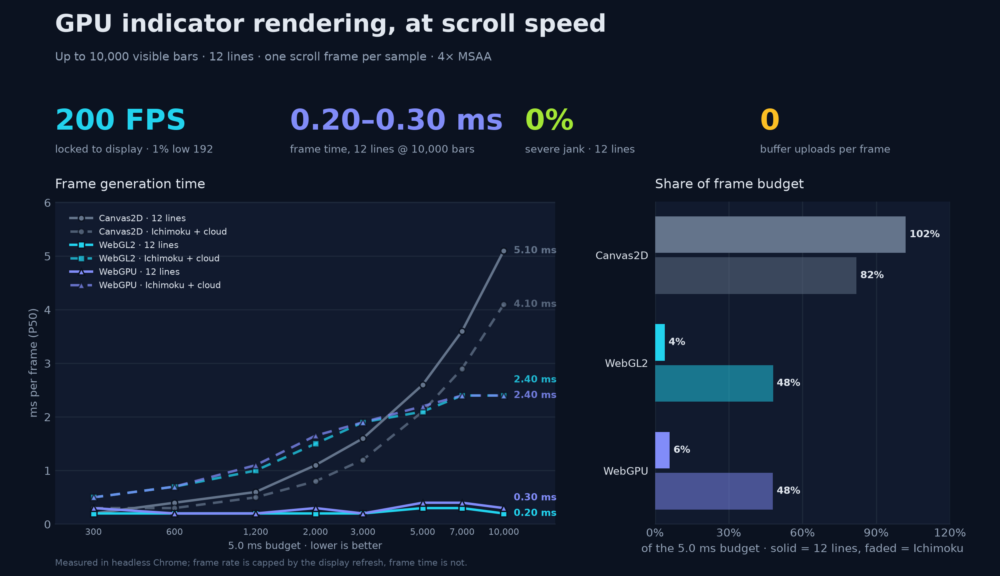
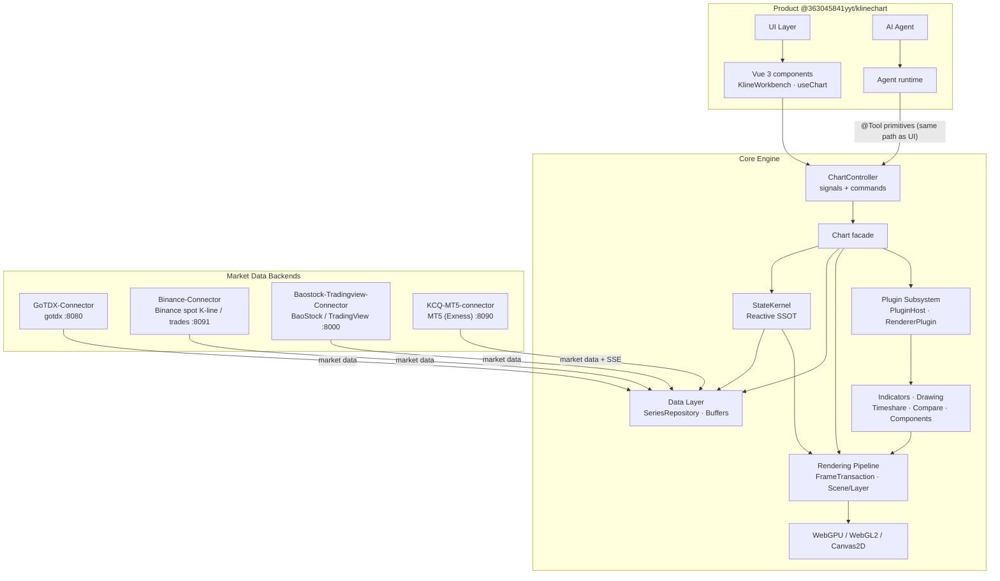

High-performance financial charting library with WebGPU / WebGL / Canvas2D rendering, a QuickJS indicator runtime, and an Agent-native API.


<div align="center">

English | [简体中文](README_CN.md)

# 📈 KLineChartQuant

[](https://www.npmjs.com/package/@363045841yyt/klinechart) [](https://www.npmjs.com/package/@363045841yyt/klinechart) [](https://github.com/363045841/klinechart/blob/main/LICENSE) [](https://363045841.github.io/KLineChartQuant/)

[](https://qm.qq.com/q/672011965) [](https://t.me/+1o-6B-wVRTU2MjQ9)

</div>

---


A lightweight financial K-line charting library for quantitative trading, with an Agent-native API and built-in script indicators.


## 🤖 Agent-Native Architecture

KLineChartQuant exposes chart capabilities as `@Tool` primitives on the chart core. The Agent calls the same entry points as the UI: one state source, one execution path, no bridge layer and no side-channel state.

- **Same primitives** — UI actions and Agent tools share `ChartController`; tools are a subset of actions.
- **Single source of truth** — `StateKernel` owns chart state; external consumers read readonly signals.
- **No MCP bridge** — tools register directly on the core, so one call reaches the kernel without a DSL or a duplicated state copy.


## ✨ Core Features

- **Agent Native** - Chart capabilities are `@Tool`-decorated domain primitives; the Agent calls the same primitives as the UI, with one shared state and one execution path
- **Script Indicators** - Write indicators in plain TypeScript. Sandboxed QuickJS execution with time and memory budgets, a built-in editor with completions and hover signatures, and plots that flow through the normal rendering chain
- **Crisp Rendering** - Full-chain ResizeObserver driven, physical pixel alignment, K-lines, wicks, and lines stay sharp on all DPR screens
- **Plugin Architecture** - Renderer plugin-based design with dynamic registration, configuration, and lifecycle management
- **High Performance** - Handles tens of thousands of data points without lag during zoom or pan; benchmark numbers are in the Performance section
- **Multi-Backend Rendering** - Submit drawing primitives once and render via **WebGPU**, **WebGL**, or **Canvas2D**, with automatic fallback. WebGPU uses a hybrid DOM canvas (no `compositeTo` copy), single-command-buffer-per-frame submission, 4x MSAA, and per-instance geometry caching via ResourceTable
- **Optimized Interaction** - Stable zoom anchor, precise crosshair cursor, smooth drag
- **Mobile-Optimized Interaction** - Long-press crosshair for data exploration, tap to dismiss, slide to browse data without triggering chart scroll, gesture-based scroll mode
- **Multi-Symbol Comparison** - Compare multiple instruments on one chart
- **Multi-Source Aggregation** - Aggregate and unify multiple data sources
- **Batch Data Export** - Select a date range and export multiple stocks' K-line data into a single CSV file, with progress indication
- **Custom Tooltip** - Fully customizable tooltip via the `#kline-tooltip` slot, with engine-provided hover data, position, and styling


## ⚡ Performance

KLineChartQuant submits drawing primitives directly to Canvas2D, WebGL2 or WebGPU. The design target is **200 FPS (5 ms per frame)**; the chart shows measured frame generation time and its share of that budget.

Benchmark: 1180 × 640 viewport, DPR 2, 4× MSAA, 300–10,000 visible K-lines, three pooled rounds per scenario. NVIDIA GeForce RTX 4060 Laptop GPU, headless Chrome 155. Reproduce it with [`bench/`](bench/README.md).




## 📐 System Architecture

KLineChartQuant is a pnpm monorepo that publishes one product package, `@363045841yyt/klinechart`.
The framework-agnostic core engine exposes a unified `ChartController` (readonly signals +
commands); the Vue layer handles mounting, event forwarding, and reactivity bridging. The AI Agent
drives the chart through the same `@Tool` primitives as the UI, sharing one state source instead of
a bridge. Everything below the Vue layer ships inside the product tarball.



- **Core engine** — headless chart engine + `ChartController`; depends on no UI framework.
- **StateKernel** — single source of truth: readonly signals for reads, actions for writes,
  `computed()` for derivation, `effect()` for DOM side effects.
- **Rendering** — submit primitives once, render via WebGPU / WebGL2 / Canvas2D with
  automatic fallback (WebGPU → WebGL → Canvas2D).
- **Data layer** — unified `SeriesRepository` + incremental buffers + fetch scheduler;
  multi-source aggregation (gotdx / BaoStock / TradingView / MT5 / mock) and Binance Spot K-lines and trades.
- **Plugin subsystem** — PluginHost / HookSystem / EventBus / RendererPluginManager;
  indicators and drawing tools plug in as Scene Layers.
- **Agent Native** — the bundled Agent runtime orchestrates the Agent, which invokes the core's
  `@Tool`-registered primitives—the same entry points the UI uses.

See [docs/architecture/architecture.md](docs/architecture/architecture.md) for the full architecture document.


## 📜 Script Indicators

Indicators can be written as plain TypeScript instead of being compiled ahead of time. A script is one file that declares a single indicator through `defineIndicator`; the engine compiles it once, then runs it bar by bar and collects Plot points. Scripts are data-source and render agnostic — the host supplies the bars, the chart adapter renders the result.

```js
defineIndicator({
  name: 'Volume Tide',
  position: Position.Sub,
  onBar() {
    const RED = '#F08080'
    const RED_LIGHT = 'rgba(240, 128, 128, 0.5)'
    const RED_LIGHTER = 'rgba(240, 128, 128, 0.15)'
    const GREEN = '#008000'
    const GREEN_LIGHT = 'rgba(0, 128, 0, 0.5)'
    const GREEN_LIGHTER = 'rgba(0, 128, 0, 0.1)'
    const GRAY_LIGHTER = 'rgba(128, 128, 128, 0.15)'

    const barUp = ta.rising(close, 1)
    const barDn = ta.falling(close, 1)
    const volumeChange = ta.change(volume)

    const volumeColor = barUp
      ? RED_LIGHTER
      : barDn ? GREEN_LIGHTER : GRAY_LIGHTER

    plot.Columns(volume, 'Volume columns', {
      color: volumeColor,
    })

    const volumeChangeColor = barUp
      ? (volumeChange > 0 ? RED : RED_LIGHT)
      : barDn
        ? (volumeChange > 0 ? GREEN : GREEN_LIGHT)
        : Color.Gray

    plot.Histogram(volumeChange, 'Volume change columns', {
      color: volumeChangeColor,
      size: 12,
    })

    plot.Line(0, 'Zero line', {
      color: Color.Gray,
    })
  },
})
```

Everything a script needs is injected as a global before it runs:

| Global | Meaning |
| --- | --- |
| `open` `high` `low` `close` `volume` `time` | price series; `close` reads the current bar, `close[1]` one bar back |
| `input.int` `input.float` `input.bool` `input.string` | declare a parameter at the top level of `onBar`; the variable reads back the user's value |
| `plot.Line` `plot.LineBR` `plot.StepLine` `plot.StepLineBR` `plot.Columns` `plot.Histogram` `plot.Point` `plot.Shape` `plot.Char` `plot.Arrow` | emit plot points; the method name selects the shape; each returns a handle |
| `plot.Candle` `plot.Bar` | emit candles or OHLC bars from four prices; candles support separate body, wick, and border colors; return `void` |
| `fill(from, to, color, title, options?)` | fill the area between two plots; `from` / `to` are handles returned by `plot.*` |
| `ta` | built-in technical analysis library |
| `Position` | `Position.Main` or `Position.Sub` |
| `Color` | common Material 400 colors, or pass any CSS color string |
| `defineIndicator` / `defineLibrary` / `importLibrary` | declare the indicator, declare a library, use a library |

`defineIndicator` also accepts an optional `title` for the long name and an optional `info` for the description shown in the indicator picker; `name` remains the stable identity and short label.

`plot.Line` connects valid points across `null` or `NaN` gaps, like Pine's `plot.style_line`. Use `plot.LineBR` to break the line at gaps, like `plot.style_linebr`. Both accept the same color, size, dash, and offset options and return handles for `fill`. Existing scripts that require gaps to break the line should use `plot.LineBR`.

`plot.StepLine` draws steps with vertical transitions halfway between valid points and connects across gaps. `plot.StepLineBR` breaks at gaps. They correspond to Pine's `plot.style_stepline` and `plot.style_steplinebr`, accept the same options as lines, and return handles for `fill`.

Trend calculations live in `ta`: `ta.atr(length)` returns Wilder ATR, and `ta.supertrend(multiplier, atrPeriod)` returns `[trend, direction]` series. Direction is `-1` for up and `1` for down; both series are `NaN` during warm-up. Supertrend preserves the previous core indicator's initial up direction. The built-in `SuperTrend` script uses these results with two `plot.LineBR` calls.

`ta.macd(source, fastLength, slowLength, signalLength)` returns `[DIF, DEA, DIF-DEA]` series. Its EMAs use the first valid value as their seed, matching the previous core MACD; regular `ta.ema` retains its full-window seed. The built-in `MACD` script uses defaults 12/26/9, doubles the histogram, and colors columns by sign and momentum. Values start at the first valid input; the migrated script supports K-line charts.

Parameters are plain `const` declarations, so the variable name is the parameter identity — no `inputs` block and no `params` object:

```js
onBar() {
  const period = input.int(20, { title: 'Period', min: 1 })
  const type = input.string('SMA', { options: ['SMA', 'EMA'] })
  plot.Line(type === 'SMA' ? ta.sma(close, period) : ta.ema(close, period), 'ma')
}
```

The built-in `ta` library covers `sma`, `ema`, `rma`, `swma`, `alma`, `wma`, `vwma`, `rsi`, `highest`, `lowest`, `highestbars`, `lowestbars`, `stoch`, `cmo`, `linreg`, `crossover`, `crossunder`, `rising`, `falling` and `change`. `highestbars` / `lowestbars` return negative bar offsets (0 is the current bar) and resolve ties to the earliest bar, matching Pine. User libraries use the same `defineLibrary` call and join the same global namespace.

- **Sandboxed execution** - Scripts run in an embedded QuickJS runtime with per-run time and memory budgets, so a runaway script fails instead of hanging the host
- **No future data** - History that is not yet available reads as `NaN`; a script can never look ahead
- **Real editor** - The chart ships a CodeMirror-based script editor with completions, hover signatures, and signature help generated from the same declarations the compiler uses
- **Same rendering path** - Plots flow through the engine's normal Plot, axis, and legend chain, so script indicators behave exactly like built-in ones

In `KlineWorkbench`, open the code editor to create, run and add scripts to the chart. The product owns the script service and registers built-in scripts automatically; no separate script package installation is needed. Set `scripts` to `false` before mounting to disable scripting and hide its editor entry.

See the [script docs](packages/script/docs/indicator.md) for the full declaration reference, [libraries](packages/script/docs/library.md), and [Plot API](packages/script/docs/indicator.md#plot).


## 📡 Data Sources

KLineChart requires a market data backend. Supported data sources:

| Data Source | Description | Docs |
|---|---|---|
| `gotdx` | Tongdaxin (GOTDX) quotes: A-share / futures / MAC, served by `GoTDX-Connector` | [GoTDX-Connector](docs/data-sources/klinechartquantgo.zh-CN.md) |
| `binance` | Binance Spot K-lines and real tick-by-tick trades (footprint / order-flow), served by `Binance-Connector` | [Binance-Connector](https://github.com/363045841/Binance-Connector) |
| `baostock` | BaoStock A-share daily / weekly / monthly & minute K-lines, served by `Baostock-Tradingview-Connector` | [BaoStock](docs/data-sources/baostock.zh-CN.md) |
| `tradingview` | TradingView global instruments, served by `Baostock-Tradingview-Connector` | [BaoStock](docs/data-sources/baostock.zh-CN.md) |
| `mt5` | MT5 (Exness) local terminal: forex / metals / crypto CFDs, served by `KCQ-MT5-connector` | [MT5](docs/data-sources/mt5.zh-CN.md) |
| `mock` | Debug only: local on-demand infinite MOCK daily bars, no backend needed, always online | — |

Backend repos live alongside this one (outside the monorepo).

### One-Command Dev Startup

Clone the data-source backends first (idempotent: skips directories that already exist):

```bash
pnpm setup:backends
```

Then run `pnpm dev` with a `-c` argument to start the frontend and the selected connectors together:

```bash
pnpm dev                      # frontend only (Vite dev server)
pnpm dev -c all               # frontend + all backends (gotdx + binance + baostock; mt5 excluded)
pnpm dev -c gotdx baostock    # frontend + selected backends
pnpm dev -c mt5               # frontend + MT5 local terminal (Windows + logged-in MT5 terminal)
pnpm dev -c tdx               # aliases supported (tdx / g / b / bnb / m / all)
pnpm dev -c all --lan         # same, dev server bound to 0.0.0.0 (LAN accessible)
```

Common shorthands:

```bash
pnpm dev:all                  # frontend + all backends
pnpm dev:g                    # frontend + gotdx (Tongdaxin)
pnpm dev:b                    # frontend + BaoStock / TradingView
pnpm dev:bnb                  # frontend + Binance spot market data
pnpm dev:mt5                  # frontend + MT5 local terminal
pnpm dev:lan:all              # frontend (0.0.0.0) + all backends
```

Parallel process logs stay in one terminal and are separated by colored source prefixes: `[vite]`, `[gotdx]`, `[binance]`, `[baostock]`, and `[mt5]`.

In Windows PowerShell, run `node scripts/dev.mjs -c gotdx` (or use the other `-c` arguments above) to finish shutdown logs before the next prompt after Ctrl+C. `pnpm dev` adds a pnpm process that also receives Ctrl+C; the child script cannot control when pnpm prints `[ELIFECYCLE]`.

Backend only (no frontend):

```bash
pnpm connector                # all backends (mt5 excluded)
pnpm connector gotdx          # gotdx (Tongdaxin) :8080
pnpm connector binance        # binance (Binance spot K-line & trades) :8091
pnpm connector baostock       # BaoStock / TradingView :8000
pnpm connector mt5            # MT5 local terminal :8090 (Windows + logged-in MT5 terminal)
```

For backend only with the same shutdown ordering, run `node scripts/start-connector.mjs gotdx`.

After `pnpm setup:backends`, no extra setup is needed. The dev server proxies `/api/stock` → `:8000` (Baostock-Tradingview-Connector) and `/api/public` → `:8080` (GoTDX-Connector).


## 🚀 Quick Start

### 1. Install

The product is one package. `vue` is the only peer dependency; the chart engine, Agent runtime, script engine, editor page, Web Workers, public types, stylesheet, and license notices are all inside the tarball.

```bash
pnpm add @363045841yyt/klinechart vue
# npm install @363045841yyt/klinechart vue
# yarn add @363045841yyt/klinechart vue
```

No `@363045841yyt/klinechart-*` internal package is published or needs to be installed. While v0.11 is in alpha, install the `alpha` dist-tag (`pnpm add @363045841yyt/klinechart@alpha vue`) or pin an exact version.

Import the product stylesheet once in your app entry:

```ts
import '@363045841yyt/klinechart/style.css'
```

### 2. Mount the workbench

```vue
<script setup lang="ts">
import { KlineWorkbench } from '@363045841yyt/klinechart'
</script>

<template>
  <div style="height: 700px">
    <KlineWorkbench />
  </div>
</template>
```

The workbench fills its container (`width/height: 100%`), so the host element must have an explicit size.

- `agent` and `scripts` default to `true`. Both are decided at mount time: set either to `false` (and remount) to disable that subsystem. Disabling scripts means no script execution Worker, no editor entry, and no language service.
- `chart` forwards chart configuration (axes, toolbar, `settings.theme`, `settings.rendererBackend`, …).
- `initialAgentPanelOpen` controls whether the Agent drawer starts open.
- Builtin script indicators are prepared before the chart mounts; the editor page and its language service load only when the editor is opened.
- Advanced Agent APIs live in the same package at `@363045841yyt/klinechart/agent`.

### 3. Provide market data

The chart never accepts a bar array. Implement `MarketDataSource`, register it on a host you own, and pass that host to the workbench.

```ts
import {
  InstrumentType,
  KLineAdjustment,
  KLinePeriod,
  createMarketDataHost,
  type BarsObserver,
  type DataSourceInstrument,
  type HistoryRequest,
  type MarketDataSource,
} from '@363045841yyt/klinechart'

// `api` and `toInstrument` are your backend adapter and payload mapping (HTTP, WebSocket, file reader, database, …).
const instrument: DataSourceInstrument = {
  id: 'BTCUSDT',
  symbol: 'BTCUSDT',
  name: 'Bitcoin / USDT',
  exchange: 'BINANCE',
  instrumentType: InstrumentType.Crypto,
  timezone: 'UTC',
  capabilities: {
    bars: { periods: [KLinePeriod.Min1, KLinePeriod.Daily], adjustments: [KLineAdjustment.None] },
    liveBars: true,
  },
}

const source: MarketDataSource = {
  id: 'binance',
  name: 'Binance Spot',
  capabilities: {
    instrumentTypes: [InstrumentType.Crypto],
    bars: { periods: [KLinePeriod.Min1, KLinePeriod.Daily], adjustments: [KLineAdjustment.None] },
    liveBars: true,
  },
  instruments: {
    // Powers the symbol picker and instrument switching.
    async search(query) {
      const matches = await api.searchSymbols(query.keyword, query.limit, query.signal)
      return matches.map(toInstrument)
    },
    // Resolves the stable id back to identity and capabilities.
    async resolve(id, signal) {
      return toInstrument(await api.getSymbol(id, signal))
    },
  },
  bars: {
    // History pages: `beforeTimestamp` is an exclusive upper bound, omitted means the newest page.
    async fetch(request: HistoryRequest) {
      const page = await api.getKlines({
        symbol: request.instrument.id,
        period: request.period,
        before: request.beforeTimestamp,
        limit: request.limit,
        signal: request.signal,
      })
      return { bars: page.bars, olderData: page.olderData }
    },
    // Optional live stream. Return an unsubscribe function.
    subscribe(request, observer: BarsObserver) {
      observer.status('connecting')
      const socket = api.subscribeBars(request.instrument.id, request.period, {
        onBar: (bar) => observer.update(bar),
        onCorrection: (bar) => observer.update(bar, { historical: true }),
        onReset: () => observer.invalidate(),
        onStatus: (status) => observer.status(status),
        onError: (error) => observer.error(error),
      })
      return () => socket.close()
    },
  },
}

const host = createMarketDataHost()
const unregister = host.registerDataSource(source)
```

Pass the host and the selected instrument to the workbench:

```vue
<script setup lang="ts">
import { KlineWorkbench } from '@363045841yyt/klinechart'

const instrument = { sourceId: 'binance', id: 'BTCUSDT' }
</script>

<template>
  <div style="height: 700px">
    <KlineWorkbench
      :market-data-context="host"
      :instrument="instrument"
      period="daily"
    />
  </div>
</template>
```

Data contract:

- `bars.fetch` returns `{ bars, olderData }`. Bars are UTC-millisecond OHLCV entries in ascending order; `beforeTimestamp` is an exclusive bound and `limit` is the requested page size.
- `olderData` is `available`, `exhausted`, or `unknown`. Declare it explicitly — an empty array is not a substitute for “no more history”.
- `observer.update(bar)` takes a full single-bar snapshot. Same last timestamp replaces, newer appends, older reports a protocol error; `observer.update(bar, { historical: true })` corrects an existing bar; `observer.invalidate()` asks for a reload after deletions or adjustment changes.
- `observer.status('connecting' | 'connected' | 'disconnected')` and `observer.error(error)` report transport state; reconnection stays the data source's responsibility.
- A source-level `liveBars` flag derives from `subscribe`; an individual instrument may declare `liveBars: false`.
- `instrument` and `period` are controlled props: change them to switch the series.
- The host belongs to your app. `unregister()` removes one source and `host.dispose()` releases everything; unmounting the workbench does not dispose the host.
- For local development without a backend, register the built-in mock instead: `host.registerDataSource(createMockDataSource())` (MOCK). The default context already contains it, so do not register it twice.

The complete contract, including trades, depth, time-share, and trading-calendar interfaces, is documented in the [data source API](docs/market-data/data-source-api.md).

### License

The complete product includes AGPL-3.0-or-later script modules and is distributed under AGPL-3.0-or-later. Individual Apache-2.0 modules retain their original licenses; module and third-party notices ship with the package.


### 4. (Optional) Add AI Agent Control

`KlineWorkbench` ships the Agent panel. The chart core exposes its domain capabilities as `@Tool`
primitives, and the Agent calls the same primitives as the UI: one shared state, one execution path,
no MCP bridge, no side-channel state. Advanced Agent APIs live in the same package at
`@363045841yyt/klinechart/agent`.


## 📖 More Documentation

- [Rendering Pipeline](docs/rendering/rendering-pipeline.md) - Current paint path: FrameTransaction, Scene/Layer, Renderer backends
- [Script Indicators](packages/script/docs/indicator.md) - Declaring an indicator in TypeScript: inputs, Plot API, libraries


## 📋 Component Props

| Prop | Type | Default | Description |
|------|------|---------|-------------|
| theme | `'light' \| 'dark'` | — | Chart theme. Use `v-model:theme` for two-way binding |
| isFullscreen | `boolean` | — | Controlled fullscreen state. Leave unbound for internal (non-controlled) mode |
| timezone | `string` | `'Asia/Shanghai'` | Time zone for date/time display |
| yPaddingPx | `number` | 20 | Y-axis padding in pixels |
| minKWidth | `number` | 1 | Minimum K-line width (logical pixels) |
| maxKWidth | `number` | 200 | Maximum K-line width (logical pixels) |
| rightAxisWidth | `number` | 0 | Right price axis width |
| leftAxisWidth | `number` | 0 | Left price axis width (0 = hidden) |
| bottomAxisHeight | `number` | 24 | Bottom time axis height |
| priceLabelWidth | `number` | 60 | Price label extra width for showing change percentage |
| zoomLevels | `number` | 80 | Total number of zoom levels |
| initialZoomLevel | `number` | 3 | Initial zoom level (1 ~ zoomLevels) |
| teleportContainer | `string \| HTMLElement` | — | Teleport target for dropdowns/modals (CSS selector or element). Defaults to internal `.chart-wrapper` |


## 🗺️ Roadmap

- [ ] Convert drawings to quantitative code


## 📦 Package

`@363045841yyt/klinechart` is the only published package. The engine, Agent runtime, script engine,
editor page, and every other monorepo module ship inside it and are not published separately.

| Package | Description | npm |
|---------|-------------|-----|
| `@363045841yyt/klinechart` | Vue 3 product: `KlineWorkbench`, `useChart`, and the full chart engine | [npm](https://www.npmjs.com/package/@363045841yyt/klinechart) |


## 🚀 What's New

- **v0.11**
  - **Agent Runtime** - A bundled Agent runtime with OpenAI protocol support, driving the chart through the same `@tool` primitives the UI uses, plus `@tool` registration, drawing Agent tools, and a shared web/Electron Agent workspace
  - **Script Indicator Engine** - One plain TypeScript file per indicator, executed in a sandboxed QuickJS runtime under time and memory budgets; built-in CodeMirror editor, a `ta` technical-analysis library, and user libraries; plots flow through the normal rendering chain, so a script indicator behaves exactly like a built-in one
  - **Drawing** - Sub-pane and timeshare drawing with workspace isolation, multi-select and batch editing, blank-area anchors, inline text editing, marquee group drag, and configurable labels
  - **Timeshare and Workspaces** - Five-day timeshare, native timeshare indicators, and persistent view workspaces
  - **Rendering** - WebGL rendering directly on the visible canvas
- **v0.10** Reworked the data layer around a unified MarketDataProvider, added multi-day timeshare, a unified indicator query pipeline shared by charts and Agents, Fibonacci/rectangle/arrow annotation tools, and promoted comparison to a first-class chart mode. Aligned the Vue/React/Angular bindings with the unified provider contract and shipped multiple rendering and state-consistency fixes.
- **v0.9.0** Self-developed Core-layer reactive state model migration, timing issues eliminated
- **v0.9.0** Single-path Scene renderer + WebGPU backend (hybrid DOM canvas, no compositeTo), FrameTransaction reactivity, device-lost recovery, auto-fallback WebGPU → WebGL → Canvas2D
- **v0.8** Symbol comparison, multi-source data aggregation
- **v0.7** Renderer registration chain AOP refactoring with decorator syntax, monorepo split, Vue/React bindings (experimental), standalone core package, tokenized color system
- **v0.6.10** Unified WebGL rendering context sharing for all panes, plus sub-pane lifecycle refactoring — centralized pane instance management via SubPaneManager with first-class paneId identity
- **v0.6.6** Comprehensive rendering optimizations: batched price-to-Y calculations, cached tick positions and geometry, optimized month-key operations; achieves stable **190-200fps on 200Hz displays** with frame generation time down to **2ms**
- **v0.6.3** WebGL rendering for K-lines, volume bars, and MACD bars; significant performance boost across the board
- **v0.6.1** Dual-layer canvas architecture: Main + Overlay separation with UpdateLevel filtering, achieves stable **180fps with low jitter on 200Hz displays**
- **v0.6.0** Stateless indicator pipeline: MA/BOLL/EXPMA/ENE/RSI/CCI/STOCH/MOM/WMSR/KST/FASTK now use unified Calculator → Scheduler → StateStore → Renderer architecture for better performance and maintainability
- **v0.5.6** Logarithmic price axis with evenly distributed grid lines at pixel level
- **v0.5.2** Advanced drawing tools: parallel channel, regression channel, smooth top/bottom, and non-intersecting channel
- **v0.5.0** Complete drawing tool system, supporting line, rectangle, text drawing and style editing
- **v0.4** Modern UI, left toolbar, right axis optimization, TradingView-style zoom feel


## Product license

The complete Vue workbench is distributed under [AGPL-3.0-or-later](packages/vue/LICENSE). Individual Apache-2.0 modules retain their original licenses. The product includes module and third-party license notices.

