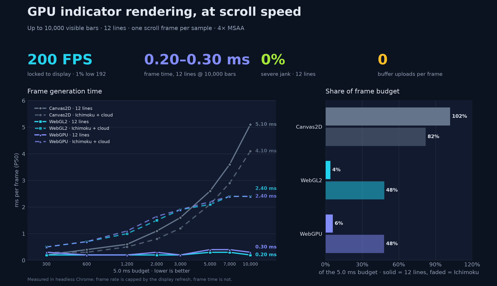
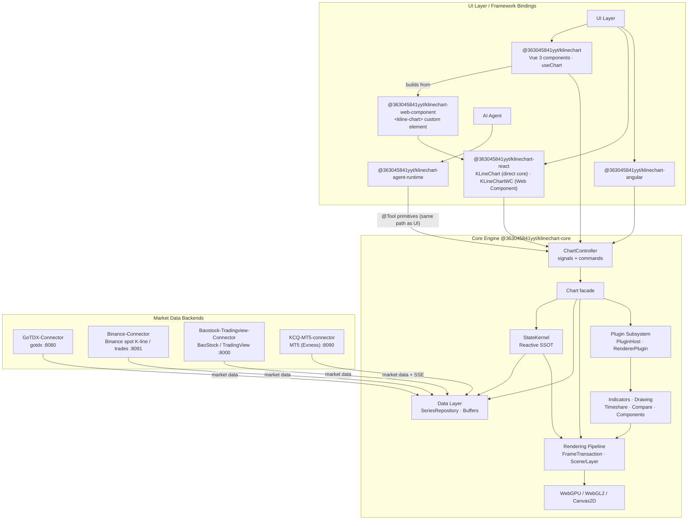

High-performance financial charting infrastructure with a single-frame generation time of just 2 ms, stable scrolling at 190–200 fps in a 200 Hz environment, a native AI-Native chart architecture, full-link ResizeObserver-driven crisp rendering, a QuickJS indicator runtime, and support for running scripts against the in-house KCQ financial analysis API to render indicators.


<div align="center">

English | [简体中文](README_CN.md)

# 📈 KLineChartQuant

**Crisp Rendering · High Performance · Optimized Interaction · Mobile-Friendly**

[](https://www.npmjs.com/package/@363045841yyt/klinechart) [](https://www.npmjs.com/package/@363045841yyt/klinechart) [](https://github.com/363045841/klinechart/blob/main/LICENSE) [](https://363045841.github.io/KLineChartQuant/)

[](https://qm.qq.com/q/672011965) [](https://t.me/+1o-6B-wVRTU2MjQ9)

</div>

---


A lightweight financial K-line charting library focused on quantitative trading scenarios. **Agent is a first-class citizen** — supports AI Agent direct control of chart operations, providing TradingView-level interaction experience.


## 🤖 Agent-Native Architecture

KLineChartQuant treats the Agent as a first-class citizen of the chart, equal in standing to the human user. It is not a chat layer bolted on top: the Agent operates the chart through the same primitives as the UI, and the endpoints it acts on are exposed by the chart core itself.

- **The Agent is the user, and the user is the Agent**: The Agent is not a guest of the chart; it is an operator with the same standing as the person in front of the screen. Everything a user can do through the UI, the Agent can do through the same entry points, and vice versa. Equality of access is the design premise, not a toggle.

- **The Agent serves the chart, not a stream of text**: An embedded Agent exists to drive the chart the user is looking at, not to bury them in prose. Its output lands as real interaction on the surface the user sees—indicators, drawings, viewport changes—with conversation only as the means. The chart and its interaction remain the subject.

- **AI-Native architecture, not a parasitic layer**: Tools are woven into the chart API primitives as aspects rather than wrapped in a separate layer, so there is one implementation, naturally consistent state, and zero bridge overhead. Zed is the reference: its agent is built into the editor's own foundation (GPUI). VS Code is the counter-example: Copilot and Claude Code enter through the extension layer, where the Claude extension is essentially a GUI wrapper around an external CLI. The former makes the Agent native; the latter makes it parasitic.

- **The Agent pushes the architecture toward stability and efficiency**: Adding an Agent adds no architectural burden; it forces the architecture to be better. Because every capability must be exposed through a single API and unified primitives, state is consolidated into one source of truth and kept absolutely consistent—scattered state, derived copies, multi-write paths, parallel pipelines, and races cannot survive. The Agent and the user travel the same path, and that constraint settles into a more stable, testable chart core.

- **No blind use of MCP**: The project evolved through three stages—an early JSON-configuration approach, then MCP, and finally an AI-Native architecture. MCP demands an intermediate layer or DSL that spends tokens, loses information, and keeps a second copy of state that invades frontend logic. The current design drops the bridge entirely: tools register directly on the chart core, and a single call reaches the kernel.

- **The reactive kernel is the Agent's foundation**: StateKernel is the single source of truth—only actions may write, computed values derive automatically, and external consumers receive readonly signals, backed by batched atomic snapshots and frozen state. The kernel is zero-dependency, extremely light, and has controllable render timing. This lets the Agent share the user's exact state at near-zero cost and keeps tools a subset of actions rather than a parallel system.


## ✨ Core Features

- **Agent Native** - The chart core exposes its capabilities as `@Tool`-decorated domain primitives, and the Agent calls the same primitives as the UI. Tools are a subset of actions: one shared state, one execution path, no bridge layer
- **Script Indicators** - Write indicators in plain TypeScript. Sandboxed QuickJS execution with time and memory budgets, a built-in editor with completions and hover signatures, and plots that flow through the normal rendering chain
- **Crisp Rendering** - Full-chain ResizeObserver driven, physical pixel alignment, K-lines, wicks, and lines are sharp and clear on all DPR screens
- **Plugin Architecture** - Renderer plugin-based design, supporting dynamic registration, configuration, and lifecycle management
- **High Performance** - Smoothly handles tens of thousands of data points, no lag during zoom or pan; supports **190-200fps on 200Hz displays** with single-frame generation time as low as **2ms**
- **Multi-Backend Rendering** - Submit drawing primitives once, render via **WebGPU**, **WebGL**, or **Canvas2D**. WebGPU provides hybrid DOM canvas (no `compositeTo` copy), single-command-buffer-per-frame submission with 4x MSAA, and per-instance geometry caching via ResourceTable. Automatic fallback chain: WebGPU → WebGL → Canvas2D. Reaching **190fps on 200Hz displays** with per-frame GPU time under **1ms**
- **Optimized Interaction** - Stable zoom anchor, precise crosshair cursor, smooth drag
- **Mobile-Optimized Interaction** - Long-press crosshair for data exploration, tap to dismiss, slide to browse data without triggering chart scroll, gesture-based scroll mode
- **Multi-Symbol Comparison** - Supports unlimited number of instruments for trend comparison
- **Multi-Source Aggregation** - Supports aggregation and unification of multiple data sources
- **Batch Data Export** - Select a date range and export multiple stocks' K-line data into a single CSV file, with progress indication
- **Custom Tooltip** - Fully customizable tooltip via the `#kline-tooltip` slot, with engine-provided hover data, position, and styling


## ⚡ Performance

KLineChartQuant submits drawing primitives directly to Canvas2D, WebGL2 or WebGPU. The design target is **200 FPS (5 ms per frame)**; the chart shows measured frame generation time and its share of that budget.

Benchmark: 1180 × 640 viewport, DPR 2, 4× MSAA, 300–10,000 visible K-lines, three pooled rounds per scenario. NVIDIA GeForce RTX 4060 Laptop GPU, headless Chrome 155. Reproduce it with [`bench/`](bench/README.md).




## 📐 System Architecture

KLineChartQuant is a pnpm monorepo. The framework-agnostic core engine exposes a unified
`ChartController` (readonly signals + commands); Vue / React / Angular bindings only handle
mounting, event forwarding, and reactivity bridging. The AI Agent drives the chart through the
same `@Tool` primitives as the UI, sharing one state source instead of a bridge.



- **Core engine** — headless chart engine + `ChartController`; depends on no UI framework.
- **StateKernel** — single source of truth: readonly signals for reads, actions for writes,
  `computed()` for derivation, `effect()` for DOM side effects.
- **Rendering** — submit primitives once, render via WebGPU / WebGL2 / Canvas2D with
  automatic fallback (WebGPU → WebGL → Canvas2D).
- **Data layer** — unified `SeriesRepository` + incremental buffers + fetch scheduler;
  multi-source aggregation (gotdx / BaoStock / TradingView / MT5 / mock) and Binance Spot K-lines and trades.
- **Plugin subsystem** — PluginHost / HookSystem / EventBus / RendererPluginManager;
  indicators and drawing tools plug in as Scene Layers.
- **React bindings** — `@363045841yyt/klinechart-react`'s `KLineChart` mounts the core directly
  (client-only, no Vue runtime); `KLineChartWC` renders the full-UI `<kline-chart>` Custom Element
  from `@363045841yyt/klinechart-web-component`, a standalone one-file bundle.
- **Agent Native** — `@363045841yyt/klinechart-agent-runtime` orchestrates the Agent, which
  invokes the core's `@Tool`-registered primitives—the same entry points the UI uses.

See [docs/architecture/architecture.md](docs/architecture/architecture.md) for the full architecture document.


## 📜 Script Indicators

Indicators can be written as plain TypeScript instead of being compiled ahead of time. A script is one file that declares a single indicator through `defineIndicator`; the engine compiles it once, then runs it bar by bar and collects Plot points. Scripts are data-source and render agnostic — the host supplies the bars, the chart adapter renders the result.

```js
defineIndicator({
  name: 'Volume Tide',
  position: Position.Sub,
  onBar() {
    const RED = '#F08080'
    const RED_LIGHT = 'rgba(240, 128, 128, 0.5)'
    const RED_LIGHTER = 'rgba(240, 128, 128, 0.15)'
    const GREEN = '#008000'
    const GREEN_LIGHT = 'rgba(0, 128, 0, 0.5)'
    const GREEN_LIGHTER = 'rgba(0, 128, 0, 0.1)'
    const GRAY_LIGHTER = 'rgba(128, 128, 128, 0.15)'

    const barUp = ta.rising(close, 1)
    const barDn = ta.falling(close, 1)
    const volumeChange = ta.change(volume)

    const volumeColor = barUp
      ? RED_LIGHTER
      : barDn ? GREEN_LIGHTER : GRAY_LIGHTER

    plot.Columns(volume, 'Volume columns', {
      color: volumeColor,
    })

    const volumeChangeColor = barUp
      ? (volumeChange > 0 ? RED : RED_LIGHT)
      : barDn
        ? (volumeChange > 0 ? GREEN : GREEN_LIGHT)
        : Color.Gray

    plot.Histogram(volumeChange, 'Volume change columns', {
      color: volumeChangeColor,
      size: 12,
    })

    plot.Line(0, 'Zero line', {
      color: Color.Gray,
    })
  },
})
```

Everything a script needs is injected as a global before it runs:

| Global | Meaning |
| --- | --- |
| `open` `high` `low` `close` `volume` `time` | price series; `close` reads the current bar, `close[1]` one bar back |
| `input.int` `input.float` `input.bool` `input.string` | declare a parameter at the top level of `onBar`; the variable reads back the user's value |
| `plot.Line` `plot.LineBR` `plot.StepLine` `plot.StepLineBR` `plot.Columns` `plot.Histogram` `plot.Point` `plot.Shape` `plot.Char` `plot.Arrow` | emit plot points; the method name selects the shape; each returns a handle |
| `plot.Candle` `plot.Bar` | emit candles or OHLC bars from four prices; candles support separate body, wick, and border colors; return `void` |
| `fill(from, to, color, title, options?)` | fill the area between two plots; `from` / `to` are handles returned by `plot.*` |
| `ta` | built-in technical analysis library |
| `Position` | `Position.Main` or `Position.Sub` |
| `Color` | common Material 400 colors, or pass any CSS color string |
| `defineIndicator` / `defineLibrary` / `importLibrary` | declare the indicator, declare a library, use a library |

`defineIndicator` also accepts an optional `title` for the long name and an optional `info` for the description shown in the indicator picker; `name` remains the stable identity and short label.

`plot.Line` connects valid points across `null` or `NaN` gaps, like Pine's `plot.style_line`. Use `plot.LineBR` to break the line at gaps, like `plot.style_linebr`. Both accept the same color, size, dash, and offset options and return handles for `fill`. Existing scripts that require gaps to break the line should use `plot.LineBR`.

`plot.StepLine` draws steps with vertical transitions halfway between valid points and connects across gaps. `plot.StepLineBR` breaks at gaps. They correspond to Pine's `plot.style_stepline` and `plot.style_steplinebr`, accept the same options as lines, and return handles for `fill`.

Trend calculations live in `ta`: `ta.atr(length)` returns Wilder ATR, and `ta.supertrend(multiplier, atrPeriod)` returns `[trend, direction]` series. Direction is `-1` for up and `1` for down; both series are `NaN` during warm-up. Supertrend preserves the previous core indicator's initial up direction. The built-in `SuperTrend` script uses these results with two `plot.LineBR` calls.

`ta.macd(source, fastLength, slowLength, signalLength)` returns `[DIF, DEA, DIF-DEA]` series. Its EMAs use the first valid value as their seed, matching the previous core MACD; regular `ta.ema` retains its full-window seed. The built-in `MACD` script uses defaults 12/26/9, doubles the histogram, and colors columns by sign and momentum. Values start at the first valid input; the migrated script supports K-line charts.

Parameters are plain `const` declarations, so the variable name is the parameter identity — no `inputs` block and no `params` object:

```js
onBar() {
  const period = input.int(20, { title: 'Period', min: 1 })
  const type = input.string('SMA', { options: ['SMA', 'EMA'] })
  plot.Line(type === 'SMA' ? ta.sma(close, period) : ta.ema(close, period), 'ma')
}
```

The built-in `ta` library covers `sma`, `ema`, `rma`, `swma`, `alma`, `wma`, `vwma`, `rsi`, `highest`, `lowest`, `highestbars`, `lowestbars`, `stoch`, `cmo`, `linreg`, `crossover`, `crossunder`, `rising`, `falling` and `change`. `highestbars` / `lowestbars` return negative bar offsets (0 is the current bar) and resolve ties to the earliest bar, matching Pine. User libraries use the same `defineLibrary` call and join the same global namespace.

- **Sandboxed execution** - Scripts run in an embedded QuickJS runtime with per-run time and memory budgets, so a runaway script fails instead of hanging the host
- **No future data** - History that is not yet available reads as `NaN`; a script can never look ahead
- **Real editor** - The chart ships a CodeMirror-based script editor with completions, hover signatures, and signature help generated from the same declarations the compiler uses
- **Same rendering path** - Plots flow through the engine's normal Plot, axis, and legend chain, so script indicators behave exactly like built-in ones

In `KlineWorkbench`, open the code editor to create, run and add scripts to the chart. The product owns the script service and registers built-in scripts automatically; no separate script package installation is needed. Set `scripts` to `false` before mounting to disable scripting and hide its editor entry.

See the [script docs](packages/script/docs/indicator.md) for the full declaration reference, [libraries](packages/script/docs/library.md), and [Plot API](packages/script/docs/indicator.md#plot).


## 📡 Data Sources

KLineChart requires a market data backend. Supported data sources:

| Data Source | Description | Docs |
|---|---|---|
| `gotdx` | Tongdaxin (GOTDX) quotes: A-share / futures / MAC, served by `GoTDX-Connector` | [GoTDX-Connector](docs/data-sources/klinechartquantgo.zh-CN.md) |
| `binance` | Binance Spot K-lines and real tick-by-tick trades (footprint / order-flow), served by `Binance-Connector` | [Binance-Connector](https://github.com/363045841/Binance-Connector) |
| `baostock` | BaoStock A-share daily / weekly / monthly & minute K-lines, served by `Baostock-Tradingview-Connector` | [BaoStock](docs/data-sources/baostock.zh-CN.md) |
| `tradingview` | TradingView global instruments, served by `Baostock-Tradingview-Connector` | [BaoStock](docs/data-sources/baostock.zh-CN.md) |
| `mt5` | MT5 (Exness) local terminal: forex / metals / crypto CFDs, served by `KCQ-MT5-connector` | [MT5](docs/data-sources/mt5.zh-CN.md) |
| `mock` | Debug only: local MOCK-100 / MOCK-10000 K-lines, no backend needed, always online | — |

Backend repos live alongside this one (outside the monorepo).

### One-Command Dev Startup

Clone the data-source backends first (idempotent: skips directories that already exist):

```bash
pnpm setup:backends
```

Then run `pnpm dev` with a `-c` argument to start the frontend and the selected connectors together:

```bash
pnpm dev                      # frontend only (Vite dev server)
pnpm dev -c all               # frontend + all backends (gotdx + binance + baostock; mt5 excluded)
pnpm dev -c gotdx baostock    # frontend + selected backends
pnpm dev -c mt5               # frontend + MT5 local terminal (Windows + logged-in MT5 terminal)
pnpm dev -c tdx               # aliases supported (tdx / g / b / bnb / m / all)
pnpm dev -c all --lan         # same, dev server bound to 0.0.0.0 (LAN accessible)
```

Common shorthands:

```bash
pnpm dev:all                  # frontend + all backends
pnpm dev:g                    # frontend + gotdx (Tongdaxin)
pnpm dev:b                    # frontend + BaoStock / TradingView
pnpm dev:bnb                  # frontend + Binance spot market data
pnpm dev:mt5                  # frontend + MT5 local terminal
pnpm dev:lan:all              # frontend (0.0.0.0) + all backends
```

Parallel process logs stay in one terminal and are separated by colored source prefixes: `[vite]`, `[gotdx]`, `[binance]`, `[baostock]`, and `[mt5]`.

In Windows PowerShell, run `node scripts/dev.mjs -c gotdx` (or use the other `-c` arguments above) to finish shutdown logs before the next prompt after Ctrl+C. `pnpm dev` adds a pnpm process that also receives Ctrl+C; the child script cannot control when pnpm prints `[ELIFECYCLE]`.

Backend only (no frontend):

```bash
pnpm connector                # all backends (mt5 excluded)
pnpm connector gotdx          # gotdx (Tongdaxin) :8080
pnpm connector binance        # binance (Binance spot K-line & trades) :8091
pnpm connector baostock       # BaoStock / TradingView :8000
pnpm connector mt5            # MT5 local terminal :8090 (Windows + logged-in MT5 terminal)
```

For backend only with the same shutdown ordering, run `node scripts/start-connector.mjs gotdx`.

After `pnpm setup:backends`, no extra setup is needed. The dev server proxies `/api/stock` → `:8000` (Baostock-Tradingview-Connector) and `/api/public` → `:8080` (GoTDX-Connector).


## 🚀 Quick Start

### Complete workbench

Install only `@363045841yyt/klinechart` and Vue 3. Internal Core, Agent, script and editor packages are included in the product and are no longer published separately.

```vue
<script setup lang="ts">
import { KlineWorkbench } from '@363045841yyt/klinechart'
import '@363045841yyt/klinechart/style.css'
</script>

<template>
  <div style="height: 700px"><KlineWorkbench /></div>
</template>
```

The workbench is the same component used by the source preview. `agent` and `scripts` default to `true`; set either to `false` before mounting to disable it. `chart` accepts chart configuration, and `marketDataContext` accepts a host-owned market data context. Script support prepares builtin indicators before mounting the chart. The editor and language service load when opened. Advanced Agent interfaces are available from `@363045841yyt/klinechart/agent` in the same package.

Implement `MarketDataSource`, register it with `createMarketDataHost().registerDataSource(source)`, and pass the host as `marketDataContext`. Select a stable instrument using `:instrument="{ sourceId, id }"` and `period`. Historical pages use `bars.fetch`; single-bar updates use the subscription observer's `update`. See the [data source API](docs/market-data/data-source-api.md).

The complete product includes AGPL-3.0-or-later script modules and is distributed under AGPL-3.0-or-later. Individual Apache-2.0 modules retain their original licenses; see the included notices.


### 4. (Optional) Add AI Agent Control

The chart core exposes its domain capabilities as `@Tool` primitives. Both the UI and the Agent call them through the same path:

```ts
import { getRegisteredChartTools } from '@363045841yyt/klinechart-core/controllers'
```

`getRegisteredChartTools()` returns every tool with its parameter schema, safety level, and unified executor. Hand them to `@363045841yyt/klinechart-agent-runtime`, which orchestrates the Agent inside your app (browser or Electron) against a Provider profile — no MCP bridge, no side-channel state. See [agent-runtime](packages/agent-runtime/README.md).


## 📖 More Documentation

- [Rendering Pipeline](docs/rendering/rendering-pipeline.md) - Current paint path: FrameTransaction, Scene/Layer, Renderer backends
- [Script Indicators](packages/script/docs/indicator.md) - Declaring an indicator in TypeScript: inputs, Plot API, libraries


## 📋 Component Props

| Prop | Type | Default | Description |
|------|------|---------|-------------|
| theme | `'light' \| 'dark'` | — | Chart theme. Use `v-model:theme` for two-way binding |
| isFullscreen | `boolean` | — | Controlled fullscreen state. Leave unbound for internal (non-controlled) mode |
| timezone | `string` | `'Asia/Shanghai'` | Time zone for date/time display |
| yPaddingPx | `number` | 20 | Y-axis padding in pixels |
| minKWidth | `number` | 1 | Minimum K-line width (logical pixels) |
| maxKWidth | `number` | 200 | Maximum K-line width (logical pixels) |
| rightAxisWidth | `number` | 0 | Right price axis width |
| leftAxisWidth | `number` | 0 | Left price axis width (0 = hidden) |
| bottomAxisHeight | `number` | 24 | Bottom time axis height |
| priceLabelWidth | `number` | 60 | Price label extra width for showing change percentage |
| zoomLevels | `number` | 80 | Total number of zoom levels |
| initialZoomLevel | `number` | 3 | Initial zoom level (1 ~ zoomLevels) |
| teleportContainer | `string \| HTMLElement` | — | Teleport target for dropdowns/modals (CSS selector or element). Defaults to internal `.chart-wrapper` |


## 🗺️ Roadmap

- [x] v0.10: AI-native chart support
- [x] K-line zoom anchor stability, improved zoom feel
- [x] Right axis detached from scroll container, completely solving clipping issues
- [x] Blank area drawing support
- [x] Limit vertical pan range to prevent viewport from leaving data
- [x] Drawing system
- [x] Right axis zoom
- [x] Latest price line and right axis label style optimization
- [x] Area primitive tools and rendering
- [x] More advanced drawing tools
- [x] Support for minute, multi-day, monthly, and yearly K-line display
- [ ] Support convert the drawing to quant code


## 📦 Packages

| Package | Description | npm |
|---------|-------------|-----|
| `@363045841yyt/klinechart-core` | Headless chart engine + controllers | [npm](https://www.npmjs.com/package/@363045841yyt/klinechart-core) |
| `@363045841yyt/klinechart` | Vue 3 bindings | [npm](https://www.npmjs.com/package/@363045841yyt/klinechart) |
| `@363045841yyt/klinechart-react` | React bindings | [npm](https://www.npmjs.com/package/@363045841yyt/klinechart-react) |
| `@363045841yyt/klinechart-angular` | Angular bindings | [npm](https://www.npmjs.com/package/@363045841yyt/klinechart-angular) |
| `@363045841yyt/klinechart-agent-runtime` | Framework-neutral Agent runtime (Pi orchestration + host contracts) | [npm](https://www.npmjs.com/package/@363045841yyt/klinechart-agent-runtime) |
| `@363045841yyt/klinechart-script` | Sandboxed script indicator engine (QuickJS runtime + language service) | [npm](https://www.npmjs.com/package/@363045841yyt/klinechart-script) |
| `@363045841yyt/klinechart-script-chart` | Registers script indicators as chart indicators | [npm](https://www.npmjs.com/package/@363045841yyt/klinechart-script-chart) |
| `@363045841yyt/klinechart-plot-contracts` | Plot declaration contracts shared by the engine and the script runtime | [npm](https://www.npmjs.com/package/@363045841yyt/klinechart-plot-contracts) |


## 🚀 What's New

- **v0.11**
  - **Agent Runtime** - `agent-runtime` and an AI runtime with OpenAI protocol support, driving the chart through the same `@tool` primitives the UI uses, plus `@tool` registration, drawing Agent tools, and a shared web/Electron Agent workspace
  - **Script Indicator Engine** - One plain TypeScript file per indicator, executed in a sandboxed QuickJS runtime under time and memory budgets; built-in CodeMirror editor, a `ta` technical-analysis library, and user libraries; plots flow through the normal rendering chain, so a script indicator behaves exactly like a built-in one
  - **Drawing** - Sub-pane and timeshare drawing with workspace isolation, multi-select and batch editing, blank-area anchors, inline text editing, marquee group drag, and configurable labels
  - **Timeshare and Workspaces** - Five-day timeshare, native timeshare indicators, and persistent view workspaces
  - **Rendering** - WebGL rendering directly on the visible canvas
- **v0.10** Reworked the data layer around a unified MarketDataProvider, added multi-day timeshare, a unified indicator query pipeline shared by charts and Agents, Fibonacci/rectangle/arrow annotation tools, and promoted comparison to a first-class chart mode. Aligned the Vue/React/Angular bindings with the unified provider contract and shipped multiple rendering and state-consistency fixes.
- **v0.9.0** Self-developed Core-layer reactive state model migration, timing issues eliminated
- **v0.9.0** Single-path Scene renderer + WebGPU backend (hybrid DOM canvas, no compositeTo), FrameTransaction reactivity, device-lost recovery, auto-fallback WebGPU → WebGL → Canvas2D
- **v0.8** Symbol comparison, multi-source data aggregation
- **v0.7** Renderer registration chain AOP refactoring with decorator syntax, monorepo split, Vue/React bindings (experimental), standalone core package, tokenized color system
- **v0.6.10** Unified WebGL rendering context sharing for all panes, plus sub-pane lifecycle refactoring — centralized pane instance management via SubPaneManager with first-class paneId identity
- **v0.6.6** Comprehensive rendering optimizations: batched price-to-Y calculations, cached tick positions and geometry, optimized month-key operations; achieves stable **190-200fps on 200Hz displays** with frame generation time down to **2ms**
- **v0.6.3** WebGL rendering for K-lines, volume bars, and MACD bars; significant performance boost across the board
- **v0.6.1** Dual-layer canvas architecture: Main + Overlay separation with UpdateLevel filtering, achieves stable **180fps with low jitter on 200Hz displays**
- **v0.6.0** Stateless indicator pipeline: MA/BOLL/EXPMA/ENE/RSI/CCI/STOCH/MOM/WMSR/KST/FASTK now use unified Calculator → Scheduler → StateStore → Renderer architecture for better performance and maintainability
- **v0.5.6** Logarithmic price axis with evenly distributed grid lines at pixel level
- **v0.5.2** Advanced drawing tools: parallel channel, regression channel, smooth top/bottom, and non-intersecting channel
- **v0.5.0** Complete drawing tool system, supporting line, rectangle, text drawing and style editing
- **v0.4** Modern UI, left toolbar, right axis optimization, TradingView-style zoom feel


## Product license

The complete Vue workbench is distributed under [AGPL-3.0-or-later](packages/vue/LICENSE). Individual Apache-2.0 modules retain their original licenses. The product includes module and third-party license notices.

