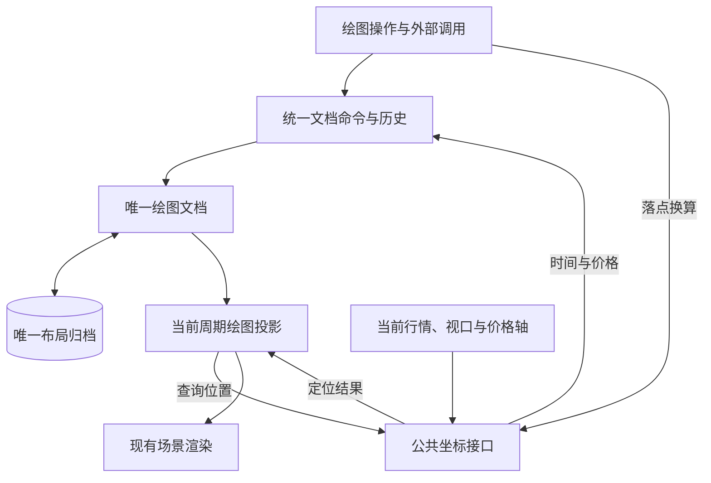

# 绘图锚点与跨周期坐标

## 持久化与投影

同一标的跨周期共用一份正式绘图文档。Kernel 是正式图元的唯一可写状态，布局是唯一持久化载体；周期只参与定位投影，不分键存储绘图副本。

用户锚点保存 `id`、`type`、绝对毫秒时间 `time` 与 Pane 价格 `price`；水平线只需要价格。未来锚点也是绝对时间，不保存相对末根 K 线的槽位偏移，也不单独标记「未来」——未来只是该时间当前大于最后一根 K 线开盘。当前周期的逻辑索引和像素坐标都是派生结果，不写回用户文档。



### 帧内投影

控制器以 `getCoordinates(paneId)` 暴露 `DrawingCoordinateApi` Interface。渲染、命中、拖动、复制与磁吸通过同一服务换算；控制器的像素换算入口也委托此服务。每个接口实例绑定一个帧上下文，调用方每次现取、不跨帧缓存坐标实例。

新建图元与拖动单个锚点时，先通过 `xToSlot` 吸附到当前周期最近槽位，再通过 `slotToTime` 保存该槽位的绝对时间。跨周期投影使用 `timeToSlot`，同样吸附到目标周期最近槽位。两个入口共用唯一取整规则，切换周期不得把目标槽位的时间回写文档，因此日线、小时线、分钟线之间往返不会累积定位误差。

`timeToLogical` 与 `logicalToTime` 是双向连续时间轴基础能力：真实行情之间二分并线性插值。脚本显式声明的 `xloc.bar_time` 使用此连续语义，例如成交量分布的柱宽；`bar_index` 保留脚本当前执行的索引语义，且不参与跨周期重定位。它们与用户手绘共享同一坐标实现。

数据两端不依赖交易日历，而是按**常规槽距**外推：常规槽距取相邻时间差中出现次数最多的正值（休市、节假日只产生更大的间隔；并列时取较小值），超出末根或早于首根的时间都按它线性延展。因此未来与过去留白都有稳定坐标，`slotToTime` 对任意整数槽位都能给出时间。真实行情覆盖该时间后，同一个 `time` 自动落到真实槽位，文档无需迁移。只有序列不足两根、无法确定槽距时，数据区间之外才没有坐标。

历史数据 prepend 后，原始时间会自然映射到新的逻辑索引。`kLineCenters` 和当前帧网格是横坐标的唯一来源，价格换算服从 Pane 当前的线性、对数或百分比轴。只读指针命中使用实际 Pane 局部位置。整体平移保留未移动的时间或价格分量，避免像素反算改写原始值。可见区间外的已解析几何由画布裁剪，端点与轴装饰只为可见锚点注册。

### Pane 与工作区

图元记录 `paneId` 作为价格坐标系的显示提示；指针命中时先解析图表 Y 对应的 Pane，再以该 Pane 的局部 Y 生成或拖拽锚点。多锚点绘制会锁定首锚点 Pane，避免一次图元跨 Pane 生成不一致的价格坐标。

图元还持久化 `workspaceId`（`kline` 或 `timeshare`）。新建图元由当前数据视图写入工作区，渲染投影、会话预览、命中和拖拽均按活动工作区过滤。缺失该字段的旧快照按 `kline` 解释。

`symbolKey` 复用行情领域的稳定标的身份，不包含周期。当前标的列表从完整文档派生，切换标的不替换文档或丢弃其他标的图元；清除只作用于当前标的，存档与历史仍使用完整文档。导入边界为缺少归属的用户图元一次性绑定标的，已归属对象和指标对象保留原身份。

图元身份只有 `id`，归属只有 `symbolKey`；`paneId` 只是本帧的显示位置，不参与身份和列表过滤。未绑定标的的用户图元不显示在任何标的下，指标图元由宿主上下文决定归属。目标周期不存在该 `paneId` 时，图元本帧不绘制，但不删除、不改绑其他 Pane。

### 轴装饰

X 轴标签注册 `timestamp` 和当前帧派生的世界 X 坐标；Y 轴标签注册 `price` 和当前帧派生的 Y 坐标。轴标签不保存或消费 `dataIndex`。

## 组合图元锚点物化

组合图元（`parallel-channel`、`flat-line`、`disjoint-channel`、`rectangle`）在创建时把派生点一次性物化为持久化锚点，之后只持久化坐标；渲染、命中、拖拽一律只读 `anchors`。拖拽跟随规则由命中目标与拖拽策略声明，不进入持久化模型。

### 物化

- 锚点数量：`getDrawingInputAnchorCount(kind)` 是用户输入数（1 / 2 / 3），`getDrawingAnchorCount(kind)` 是补齐后的持久化数（通道与矩形为 4）。
- `materializeDrawingAnchors(kind, anchors, createAnchorId)` 把输入补齐。第三个输入锚点只提供价格，时间被忽略：派生点复制首两点的时间坐标，因此不依赖时间轴能力，也没有派生索引越界的失败路径。
  - `parallel-channel`：两条线跨越同样的首两点时间，斜率相同。第 3 点取次点时间 + 第三个输入价格（光标落在次点时间槽上跟手）；第 2 点取首点时间，价格 = `third.price − (second.price − first.price)`。
  - `disjoint-channel`：两条线跨越同样的首两点时间，斜率互为相反数。第 2 点取次点时间 + 第三个输入价格；第 3 点取首点时间，价格 = `third.price + (second.price − first.price)`。
  - `flat-line`：两个水平端点分别落在首两点的时间上，价格同取第三个输入价格。
  - `rectangle`：两个对角输入补齐为顺时针四角（左上、右上、右下、左下）。时间取两输入点的较小 / 较大者，价格取较大 / 较小者，因此两个对角点谁先谁后都不影响结果；四角顺序与 `LINES` 的四条边、`FILL_ANCHOR_ORDERS` 的环绕顺序一致。输入仍是两次点击，脚本 `box` 在创建时也直接产出四角，模型里不存在「两锚点矩形」。
- 同 X 配对：`parallel-channel` / `flat-line` 为 `0↔2`、`1↔3`；`disjoint-channel` 为 `0↔3`、`1↔2`——它的第 2 点是第二条线的右端、第 3 点是左端，由「第二条线端点 = 首两点时间 + 负斜率」唯一确定，不是 `flat-line` 的左右同价平移。
- 导入的旧 3 锚点快照在 `replaceDrawings` 时走同一函数补齐；旧的两锚点矩形同样在此补齐为四角。

### 帧内消费

绘图定义直接读 4 个持久化锚点，线段由线表（`geometry/impl/lines.ts`）声明的锚点对构成，不再按 kind 推导。`rectangle` 的四条边同样来自线表，`extend` 只延长上下两边、不封口竖边。只有 `regression-channel` 保留 `computedAnchors`：端点是数据拟合结果，无固定坐标可持久化，命中时映射回两个范围锚点。

`parallel-channel` 额外在同 X 端点的中点连线上画一条虚线中线（`showEndpoints: false`），观感对齐 `regression-channel` 的中间回归线；中线纯装饰，不参与锚点、命中与拖拽。

### 命中

命中目标有三种：`{ type: 'anchor', index }`（锚点）、`{ type: 'line-handle', lineIndex }`（线中点手柄）、`{ type: 'all' }`（图元主体）。锚点命中覆盖全部持久化锚点；线段与填充都属于「图元主体」。

填充命中覆盖四个四锚点图元：填充多边形顶点顺序由 `fillRegions.ts` 的唯一一张表声明，绘制（`createXxxDefinition` 的 `area`）与命中（点在多边形内判定）共用同一份顺序，不会各自漂移。不相交通道第二条线方向相反，环绕顺序与另两者不同，单独登记。命中优先级为锚点 > 中点手柄 > 线段 > 填充；回归通道的填充仍由线段构成，不登记环绕顺序。

### 中点手柄

中点手柄是派生量：位置取线表锚点对的中点，每次投影现算，不持久化。线表为每条线声明 `handle` 轴：

- `price`：上下平移这条线（通道两条线、矩形上下边），光标 `ns-resize`。
- `time`：左右平移这条线（矩形左右边），光标 `ew-resize`。
- `null`：这条线不出手柄。

命中、绘制、拖动都读同一个 `resolveLineHandle(kind, lineIndex)`，`DragHandler` 只按轴换算增量（价格增量 / 屏幕 X 位移），不认识 kind。手柄只在图元被选中时出现并参与命中。

计算出来的几何（`regression-channel` 的上下轨）没有中点手柄：手柄 = 位置 + 写回目标，而拟合轨道没有可写的持久化锚点，改宽度属于参数（属性面板），不是画布手势。

### 拖拽策略

- `AnchorDragFollowers` / `resolveAnchorFollowers(kind, index)` 只回答「拖锚点 `index` 时哪些锚点一起动」。每项声明 `follow`：`time` / `price` 各取 `1` 同向、`-1` 反向、`0` 不跟随（缺省 1）；被拖锚点自身始终接受完整位移，未登记的图元只动被拖锚点。
- `DragHandler` 不认识 `kind`：锚点目标按 `resolveAnchorFollowers` 求移动组并按 `follow` 加权，整体目标对全部锚点施加同一屏幕位移；位移到时间 / 价格的换算仍由 `DragHandler` 统一完成。
- 已登记策略：
  - `parallel-channel`：端点按角色跨线成对（`0/2` 左端、`1/3` 右端）。拖任一端点时，另一条线上的同角色端点按同一位移跟随，剩下两点固定，两条线向量始终相同。
  - `flat-line`：`0/1` 斜线、`2/3` 水平线。同侧共享 X、水平线两端共享价格。拖斜线端点时水平线同侧端点只跟时间；拖水平线端点时斜线同侧端点只跟时间（`follow: { time: 1, price: 0 }`）、水平线另一端只跟价格（`follow: { time: 0, price: 1 }`）。
  - `disjoint-channel`：同 X 伙伴时间同向、价格反向（`follow: { time: 1, price: -1 }`），剩下两点固定；创建期不变量（`x(0) = x(3)`、`x(1) = x(2)`、`p(2) − p(3) = −(p(1) − p(0))`）在点拖与整体拖拽后都成立。
  - `rectangle`：拖一个角时，同横边的对角保持 X、跟随价格（`follow: { time: 0, price: 1 }`），同竖边的对角保持价格、跟随 X（`follow: { time: 1, price: 0 }`），对角点固定，矩形始终保持轴对齐。
  - `regression-channel`：不做拖拽策略，命中映射回范围锚点后走缺省行为。

## 交易日解析错误码

`findAnchorAtTradingDate` 返回可判别联合，并按原因抛不同错误码；不再用 `null` 同时表示范围外、非交易日与能力缺失。

| 原因 | 语义 | 可自纠的修正 |
| --- | --- | --- |
| 日期早于已加载最早 / 晚于最晚 | 范围外 | 改到 `[earliest, latest]` 内 |
| 日期在范围内但没有 bar | 非交易日 / 停牌 | 改成一个有 bar 的日期 |
| 数据源未提供每根 bar 的 `date` | 能力缺失 | 与日期无关，重试无效 |

契约：

```ts
export type AnchorTradingDateResolution =
  | { readonly kind: 'resolved'; readonly timestamp: number }
  | { readonly kind: 'out-of-range'; readonly earliest: string; readonly latest: string }
  | { readonly kind: 'not-trading' }
  | { readonly kind: 'date-unavailable' }
```

- `DrawingDocumentDependencies.findAnchorAtTradingDate` 返回该联合，不再返回 `null`。
- 原因判别在适配器完成（它持有 `chart.getData()`），错误码映射留在 `DrawingDocument`（领域语义的唯一归属）。
- `earliest` / `latest` 用 `string`：`KLineData.date` 从协议层起就是可选 `string`，不做不安全断言。

错误码（append-only）：

| 错误码 | 触发条件 | details |
| --- | --- | --- |
| `DRAWING_ANCHOR_DATE_OUT_OF_RANGE` | 日期在已加载范围之外 | `tradingDate, earliest, latest` |
| `DRAWING_ANCHOR_DATE_NOT_TRADING` | 日期在范围内但当天无 bar | `tradingDate` |
| `DRAWING_ANCHOR_DATE_UNAVAILABLE` | 数据无 per-bar `date` | `tradingDate` |

有限时间戳直接作为文档事实保存，不要求精确命中当前周期的 K 线。`DRAWING_ANCHOR_NOT_FOUND` 按错误码 append-only 规则保留编号，当前时间戳创建路径不再抛出该码；视图未就绪时公共坐标接口返回空值，数据区间之外由常规槽距外推。

Agent 层 `drawingCreateFailure` 按错误码返回各自的 `code` / `expected` / `recovery`；范围外与范围值直接带出 `earliest`、`latest`，修正所需信息随失败一起返回。

边界：不注入全量交易日；不把「日期在范围内但无 bar」改为吸附（会改变用户意图）；日内周期下日期命中多根 bar 目前取首根。
