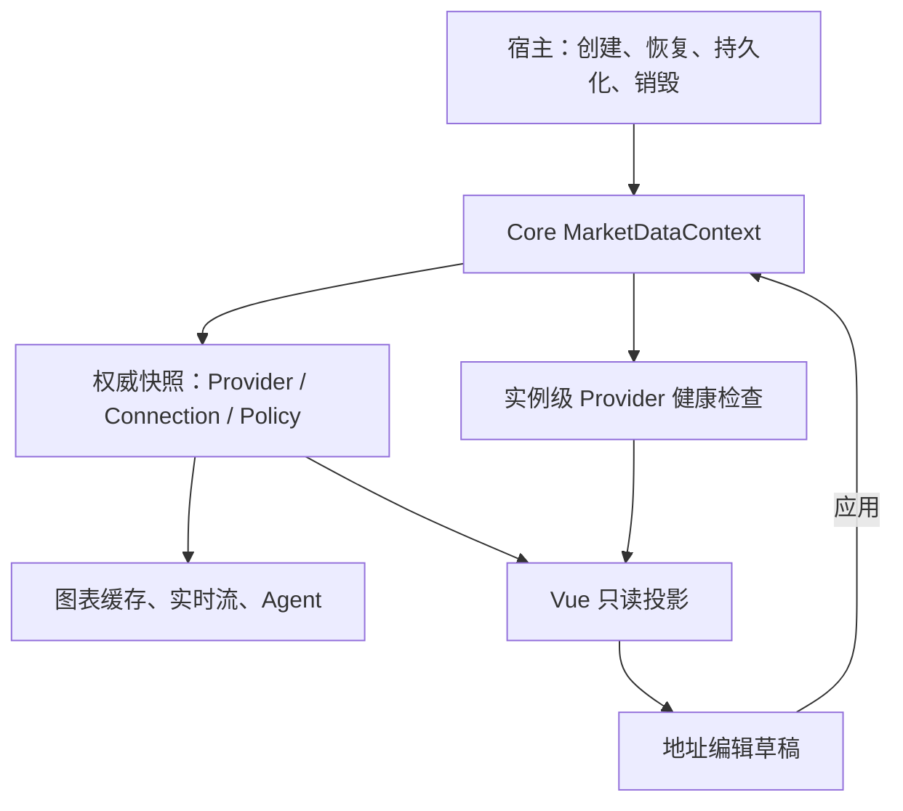

# 行情管理实例

宿主创建 `MarketDataContext`，通过 `ChartMountOptions.marketDataContext`、Vue
`marketDataContext` prop 或 `MARKET_DATA_CONTEXT_KEY` 注入图表。多个图表共享同一个实例时，
连接配置和健康状态共享；不同实例的 Provider 与 transport 必须分别装配。
内置源可通过 `createBuiltinMarketDataContext()` 创建。

Connection 以明确的 `connectionId` 关联 Provider。BaoStock 与 TradingView 共用
`baostock-tradingview`，地址只保存一次。连接配置变化增加版本，旧拨测结果失效，
旧缓存请求取消，活动实时流重新订阅。Provider 的健康结果分别探测，不将一个上游
在线推断为其他上游在线。

`enabled` 控制自动行情路由及显式查询的可用性；`searchEnabled` 独立控制品种搜索。
`priority` 决定自动路由和搜索的顺序。配置与目录来自注册表中的唯一快照，Vue 不另存
生效状态，不直接访问 localStorage。表单草稿只有提交后才成为生效配置。

宿主用 `configuration.peek()` 导出可持久化配置，监听 `configuration.subscribe()`
保存变更，用 `restore()` 恢复。凭据由宿主提供的 transport 管理，不进入配置导出。
宿主管理的连接声明 `endpointEditable: false`，管理界面和恢复偏好均不能覆盖地址。

组件卸载只释放自身订阅；共享健康请求按 Provider 和连接版本复用，分别计时和超时。
实例的 `dispose()` 只由宿主调用。未注入实例的旧宿主仍使用默认实例，但默认实例不
隐式加载或保存浏览器偏好。示例宿主的集成见 `packages/vue/preview/marketDataHost.ts`。
