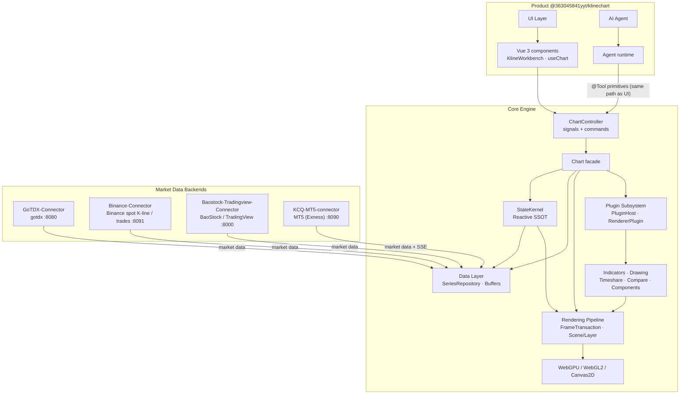

## 📐 System Architecture

KLineChartQuant is a pnpm monorepo that publishes one product package, `@363045841yyt/klinechart`.
The framework-agnostic core engine exposes a unified `ChartController` (readonly signals +
commands); the Vue layer handles mounting, event forwarding, and reactivity bridging. The AI Agent
drives the chart through the same `@Tool` primitives as the UI, sharing one state source instead of
a bridge. Everything below the Vue layer ships inside the product tarball.

- **Core engine** — headless chart engine + `ChartController`; depends on no UI framework.
- **StateKernel** — single source of truth: readonly signals for reads, actions for writes,
  `computed()` for derivation, `effect()` for DOM side effects.
- **Rendering** — submit primitives once, render via WebGPU / WebGL2 / Canvas2D with
  automatic fallback (WebGPU → WebGL → Canvas2D).
- **Data layer** — unified `SeriesRepository` + incremental buffers + fetch scheduler;
  multi-source aggregation (gotdx / BaoStock / TradingView / MT5 / mock) and Binance Spot K-lines and trades.
- **Plugin subsystem** — PluginHost / HookSystem / EventBus / RendererPluginManager;
  indicators and drawing tools plug in as Scene Layers.
- **Agent Native** — the bundled Agent runtime orchestrates the Agent, which invokes the core's
  `@Tool`-registered primitives—the same entry points the UI uses.

See [docs/architecture/architecture.md]({{root}}docs/architecture/architecture.md) for the full architecture document.
