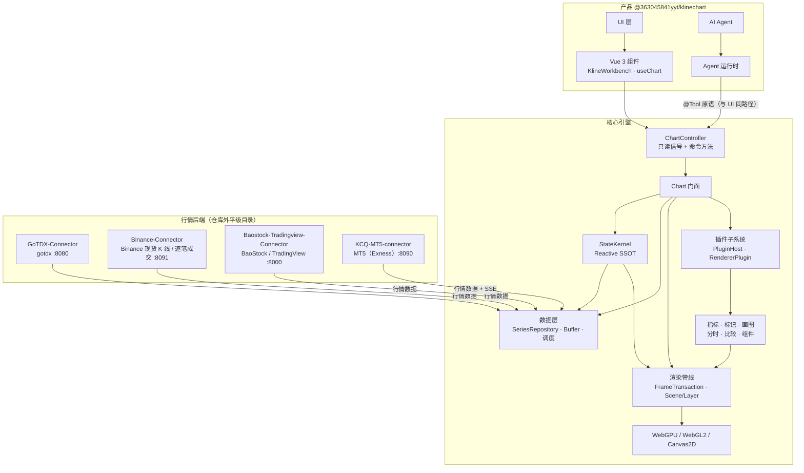

## 📐 系统架构

KLineChartQuant 是一个 pnpm monorepo，只发布一个产品包 `@363045841yyt/klinechart`。核心引擎不依赖
任何 UI 框架，通过统一的 `ChartController`（只读信号 + 命令方法）对外暴露能力；Vue 层只负责挂载、
事件转发与响应式桥接。AI Agent 通过与 UI 相同的 `@Tool` 原语直接驱动图表，共享同一状态源，而非
桥接层。Vue 层以下的全部模块都随产品 tarball 交付。

- **核心引擎** — 无头图表引擎 + `ChartController`，不依赖任何 UI 框架。
- **StateKernel** — 状态单一事实源：只读信号读、action 写、`computed()` 派生、
  `effect()` 副作用。
- **渲染** — 图元一次提交，WebGPU / WebGL2 / Canvas2D 三后端渲染，自动降级
  （WebGPU → WebGL → Canvas2D）。
- **数据层** — 统一 `SeriesRepository` + 增量缓冲 + 拉取调度；多数据源聚合
  （gotdx / BaoStock / TradingView / MT5 / mock）与 Binance 现货 K 线 / 逐笔成交。
- **插件子系统** — PluginHost / HookSystem / EventBus / RendererPluginManager；
  指标、标记、画图以 Scene Layer 形式接入。
- **Agent 原生** — 随包交付的 Agent 运行时编排 Agent，直接调用核心 `@Tool` 注册的原语——
  与 UI 使用同一入口。

完整架构文档见 [docs/architecture/architecture.md]({{root}}docs/architecture/architecture.md)。
